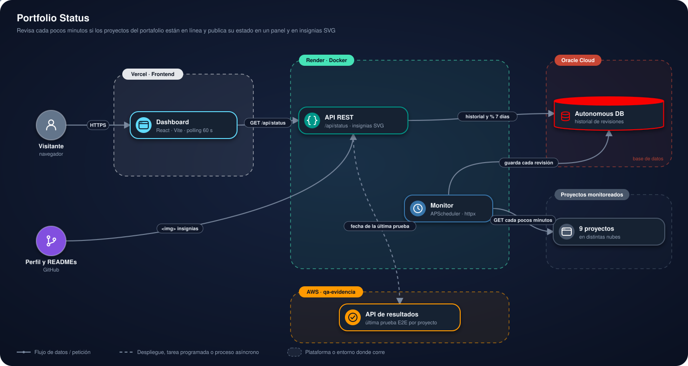

# Portfolio Status · Monitor de disponibilidad

<p>
  <a href="https://frontend-nine-topaz-99.vercel.app"></a>
  <a href="https://frontend-nine-topaz-99.vercel.app"></a>
  <a href="https://d4i3vsgw7xwmh.cloudfront.net"></a>
</p>


> 📘 **[Manual de usuario](docs/MANUAL.md)**: cómo leer el panel y usar las insignias, con imágenes.

## Contenido

1. [Presentación](#1-presentación)
2. [Funcionalidades](#2-funcionalidades)
3. [Arquitectura](#3-arquitectura)
4. [Estructura del proyecto](#4-estructura-del-proyecto)
5. [Instalación para pruebas](#5-instalación-para-pruebas)
6. [Autor y licencia](#6-autor-y-licencia)

---

## 1. Presentación

Panel en vivo que revisa automáticamente si cada proyecto del portafolio sigue en línea y qué tan
rápido responde, con su historial de disponibilidad y una tarjeta por proyecto con enlace directo a
su demo.

- **Qué hace:** cada pocos minutos visita la dirección de cada proyecto, anota si respondió y en
  cuánto tiempo, y guarda ese historial (15 días; el panel muestra los últimos 7).
- **Dónde se ve:** en el [panel](https://frontend-nine-topaz-99.vercel.app/) y en las insignias
  en vivo del perfil de GitHub y del README de cada proyecto.

## 2. Funcionalidades

- Estado actual de cada proyecto: **Funcionando**, **Lento** o **No responde**.
- Tiempo de respuesta, porcentaje de disponibilidad de la semana e historial en barras.
- Insignias SVG con el estado de cada proyecto y la fecha de su última prueba E2E.
- Tema claro y oscuro, instalable como aplicación y adaptable a celular, tablet y computador.

## 3. Arquitectura

<p align="center">
  
</p>

| Capa | Tecnología |
|---|---|
| Monitor y API | Python, FastAPI, APScheduler y httpx |
| Panel | React y Vite; se actualiza cada 60 segundos |
| Datos | Base de datos relacional con el historial de revisiones |

## 4. Estructura del proyecto

```
backend/     Monitor y API (FastAPI)
frontend/    Panel visual (React + Vite)
db/          Script para crear la tabla del historial
docs/        Manual de usuario y diagramas
```

## 5. Instalación para pruebas

1. Crea la tabla con `db/001_crear_esquema.sql` en tu propia base de datos.
2. Backend:

   ```bash
   cd backend
   cp .env.example .env   # complétalo con tus propios valores
   pip install -r requirements.txt
   uvicorn app.main:app --reload
   ```

3. Panel:

   ```bash
   cd frontend
   cp .env.example .env
   npm install
   npm run dev
   ```

## 6. Autor y licencia

**Luis F. A.** · [GitHub](https://github.com/lariasca1994) · [LinkedIn](https://linkedin.com/in/lfac1)

Contacto: Telegram [@lfac6](https://t.me/lfac6) · WhatsApp [@carraian160](https://wa.me/carraian160) ·
[ariascluisf@hotmail.com](mailto:ariascluisf@hotmail.com)

Licencia: MIT.
