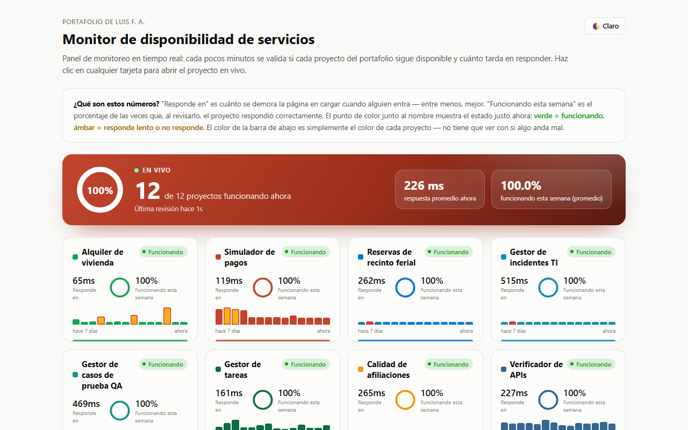
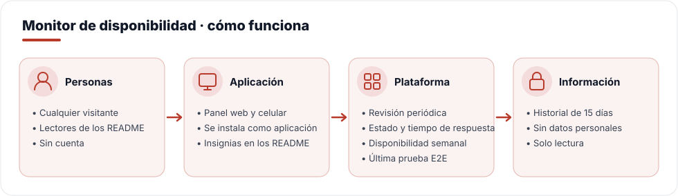
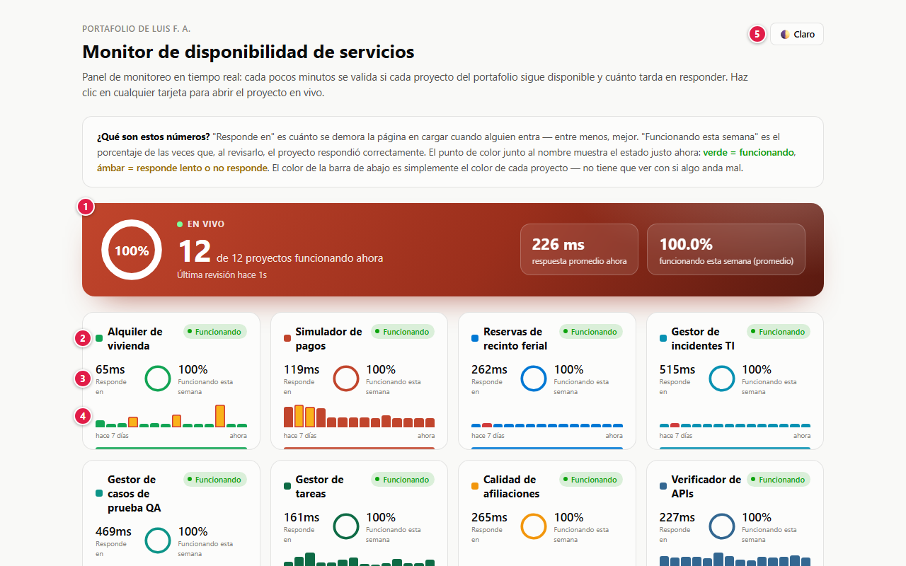
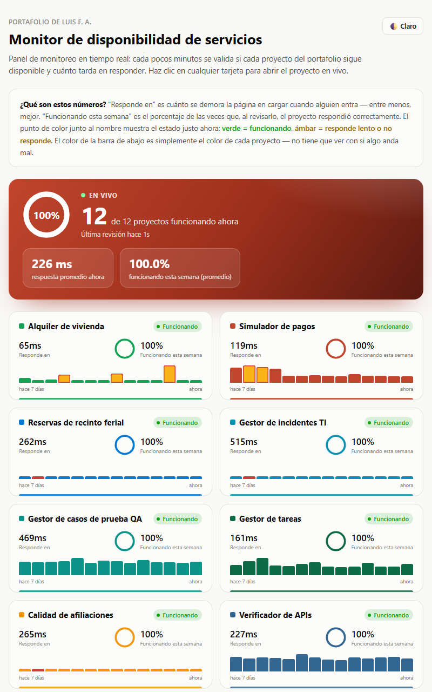
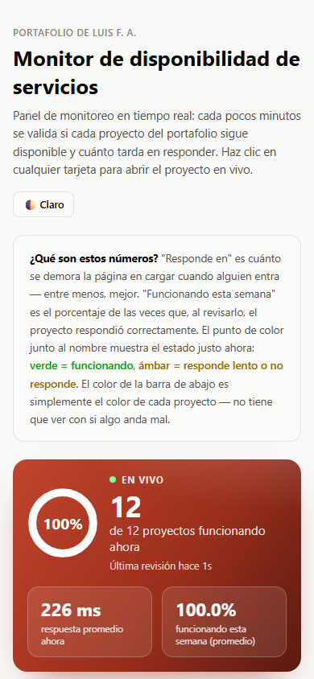
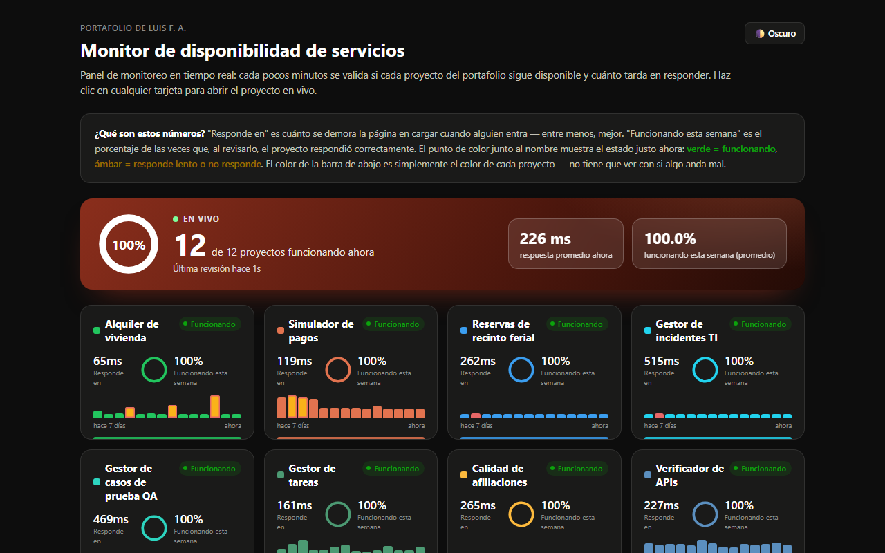
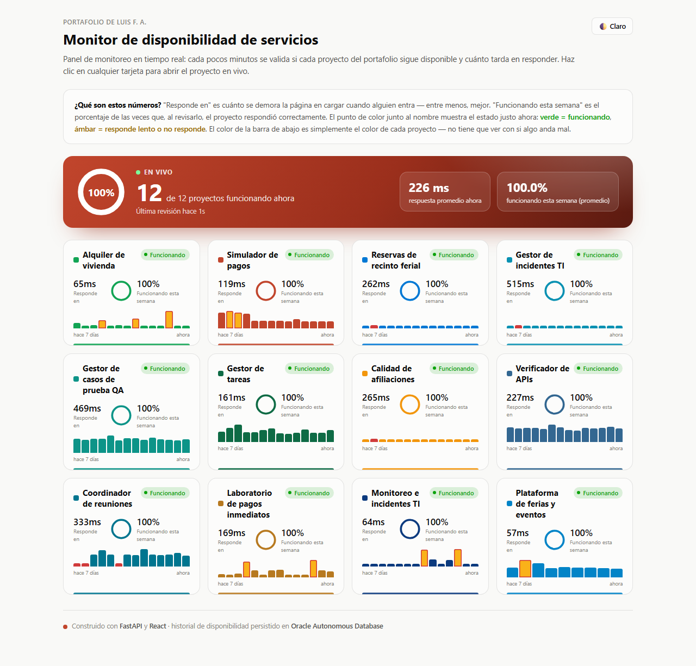
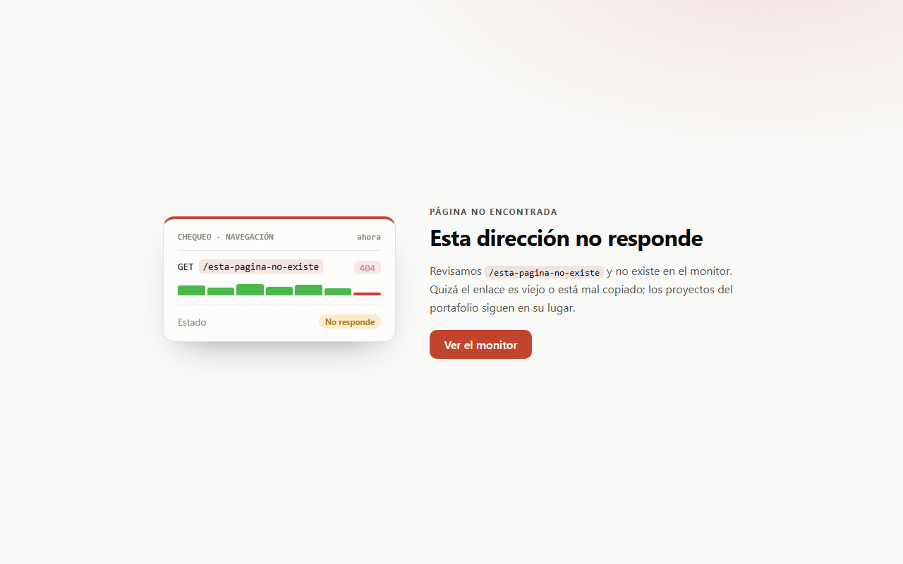
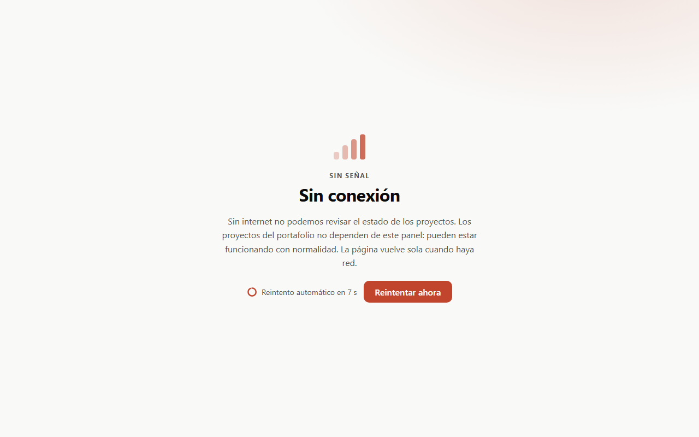

# 📘 Manual de usuario · Monitor de disponibilidad (Portfolio Status)

## 1. Portada

| | |
|---|---|
| **Producto** | Monitor de disponibilidad de servicios (Portfolio Status) |
| **Documento** | Manual de usuario |
| **Versión** | 2.0 · noviembre de 2026 |
| **Dirigido a** | Cualquier persona que quiera saber si los proyectos del portafolio están en línea |
| **Dirección** | [Monitor de disponibilidad](https://frontend-nine-topaz-99.vercel.app/) |
| **Autor** | Luis F. A. |

## Contenido

1. [Portada](#1-portada)
2. [Introducción](#2-introducción)
3. [Objetivo](#3-objetivo)
4. [Alcance](#4-alcance)
5. [Acceso al sistema](#5-acceso-al-sistema)
6. [Pantalla principal](#6-pantalla-principal)
7. [Navegación](#7-navegación)
8. [Funcionalidades](#8-funcionalidades)
9. [Gestión de perfil](#9-gestión-de-perfil)
10. [Mensajes frecuentes](#10-mensajes-frecuentes)
11. [Preguntas frecuentes](#11-preguntas-frecuentes)
12. [Glosario](#12-glosario)

---

## 2. Introducción

El **Monitor de disponibilidad** revisa cada pocos minutos si cada proyecto del portafolio sigue en
línea y cuánto tarda en responder. Muestra el resultado en un panel con una tarjeta por proyecto y en
insignias que aparecen en el README de cada uno.

## 3. Objetivo

Que cualquier persona pueda ver, de un vistazo y sin conocimientos técnicos, qué proyectos están
funcionando, cuáles responden lento y cómo les ha ido en la semana.

## 4. Alcance

**Incluye:** estado actual de cada proyecto, tiempo de respuesta, disponibilidad de los últimos 7
días, historial en barras, insignias para los README y uso en celular, tablet y computador.

**No incluye:** revisar proyectos de terceros: solo los del portafolio.

**Qué necesitas:** un navegador y conexión a internet.

## 5. Acceso al sistema

No necesitas cuenta: el panel es público y solo muestra información. Abre la
[dirección del panel](https://frontend-nine-topaz-99.vercel.app/) y verás el estado de todos los
proyectos.

## 6. Pantalla principal

| # | Elemento | Qué muestra |
|:-:|---|---|
| 1 | Tarjeta principal | Cuántos proyectos funcionan ahora, la respuesta promedio y la disponibilidad de la semana; **En vivo** late mientras el panel se actualiza solo |
| 2 | Nombre y estado | **Funcionando** (verde), **Lento** o **No responde** (ámbar); si lleva más de un día sin revisión dice **N d sin revisar** |
| 3 | Cifras | **Responde en** (cuánto tardó la última vez) y **Funcionando esta semana** (porcentaje de revisiones correctas) |
| 4 | Barras | Historial de "hace 7 días" a "ahora"; las resaltadas marcan revisiones lentas o fallidas |
| 5 | Claro / Oscuro | Cambia el tema |

## 7. Navegación

Es una sola página: desplázate hacia abajo para ver todas las tarjetas. Al pulsar una tarjeta se
abre la demo de ese proyecto. En la tablet y en el celular las tarjetas se acomodan en dos columnas o
en una.

| Tablet en vertical | Celular |
|:-:|:-:|
|  |  |

El tema oscuro se ve así:

## 8. Funcionalidades

### 8.1 Crear

No hay nada que crear: el panel es de solo lectura. Las revisiones las hace el monitor solo.

### 8.2 Consultar: el panel completo

### 8.3 Modificar

No aplica: la información se actualiza sola cada 60 segundos.

### 8.4 Reportar: insignias

Cada insignia es una imagen que se puede poner en cualquier README:

| Insignia | Dirección |
|---|---|
| Resumen del portafolio | `https://portafolio-status.onrender.com/api/status/badge.svg` |
| Última corrida E2E del portafolio | `https://portafolio-status.onrender.com/api/status/qa-badge.svg` |
| Estado de un proyecto | `https://portafolio-status.onrender.com/api/status/{proyecto}/badge.svg` |
| Última prueba E2E de un proyecto | `https://portafolio-status.onrender.com/api/status/{proyecto}/qa-badge.svg` |

## 9. Gestión de perfil

No aplica: el panel no tiene cuentas ni datos personales. La única preferencia, el tema claro u
oscuro, se recuerda en tu navegador.

## 10. Mensajes frecuentes

| Mensaje | Qué significa | Qué hacer |
|---|---|---|
| Lento | El proyecto tardó más de lo normal | Suele ser un servicio que despertaba; se normaliza solo |
| No responde | El proyecto no contestó en la última revisión | Se vuelve a revisar en pocos minutos |
| N d sin revisar | No hay revisiones recientes de ese proyecto | Espera a la siguiente franja de revisión |
| Estamos en mantenimiento | El servicio del monitor no responde ahora | La pantalla reintenta sola cada 15 segundos |
| Esta dirección no responde | La dirección no existe | Usa **Ver el monitor** |
| Sin conexión | Tu equipo no tiene internet | La pantalla reintenta sola |

| Página no encontrada | Sin conexión |
|:-:|:-:|
|  |  |

## 11. Preguntas frecuentes

**¿Por qué un proyecto aparece "Lento" o "No responde" y luego se recupera?** Varios proyectos se
suspenden cuando nadie los usa; la primera visita los despierta y tarda más.

**¿Cada cuánto se revisa cada proyecto?** Los que están siempre encendidos, cada pocos minutos. Los
que se suspenden sin uso, a las 8, 12, 16 y 20 h de Bogotá.

**¿Cuánto tiempo se guarda el historial?** 15 días; el panel muestra los últimos 7.

**¿Puedo instalarlo como aplicación?** Sí: en Chrome o Edge, **Instalar aplicación**; en iPhone,
Safari → **Compartir → Agregar a inicio**.

**¿Dónde pido ayuda o reporto un problema?** Telegram [@lfac6](https://t.me/lfac6), WhatsApp
[@carraian160](https://wa.me/carraian160) o [ariascluisf@hotmail.com](mailto:ariascluisf@hotmail.com).

## 12. Glosario

| Término | Qué significa |
|---|---|
| **Disponibilidad** | Porcentaje de revisiones en que el proyecto respondió bien |
| **E2E** | Prueba automática que recorre el proyecto como lo haría una persona |
| **Insignia** | Pequeña imagen con el estado de un proyecto, para poner en un README |
| **Tiempo de respuesta** | Cuánto tarda el proyecto en contestar, en milisegundos (ms) |
