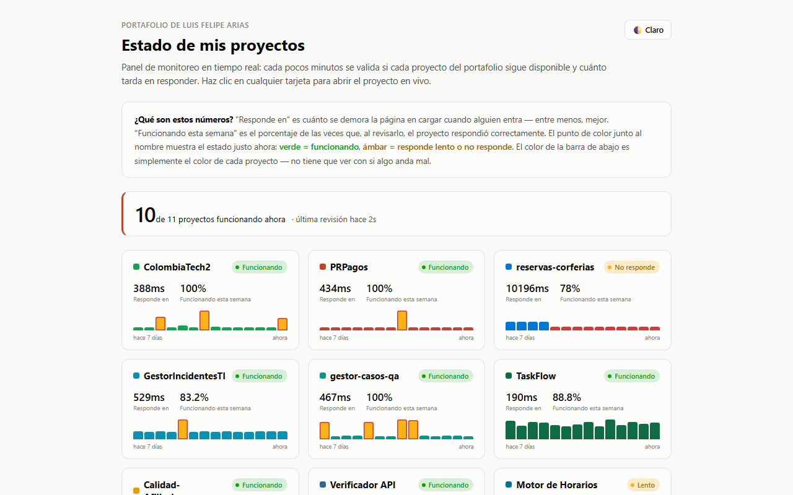
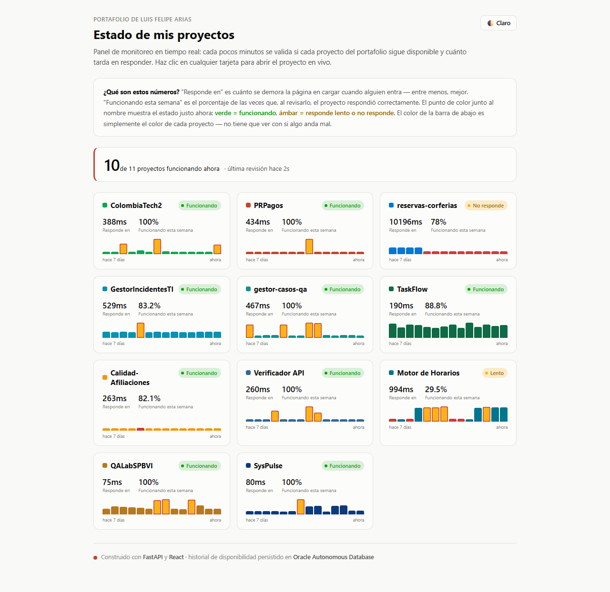

# 📘 Manual de usuario · Portfolio Status

Guía para leer el panel y usar las insignias: qué muestra cada dato, qué información se maneja y
qué protege la plataforma. Para la parte técnica vuelve al [README](../README.md).

**Panel:** [frontend-nine-topaz-99.vercel.app](https://frontend-nine-topaz-99.vercel.app/) ·
**API:** [portafolio-status.onrender.com](https://portafolio-status.onrender.com/)

## Contenido

1. [En pocas palabras](#1-en-pocas-palabras)
2. [Antes de empezar](#2-antes-de-empezar)
3. [Paso a paso](#3-paso-a-paso)
4. [Qué información se maneja y dónde queda](#4-qué-información-se-maneja-y-dónde-queda)
5. [Seguridad: qué se garantiza](#5-seguridad-qué-se-garantiza)
6. [Preguntas frecuentes](#6-preguntas-frecuentes)

---

## 1. En pocas palabras

Cada pocos minutos, el backend visita la dirección de cada proyecto del portafolio, anota si
respondió y en cuánto tiempo, y guarda el historial. El panel lo muestra en tarjetas, y las
insignias en vivo lo llevan a los README de GitHub.

## 2. Antes de empezar

- El panel es **público**: no pide cuenta ni datos.
- Se actualiza solo cada 60 segundos; no hace falta recargar.

## 3. Paso a paso

### 3.1 Leer el panel



| Elemento | Qué significa |
|---|---|
| Contador superior | Cuántos proyectos funcionan ahora y hace cuánto fue la última revisión |
| Punto y etiqueta de estado | **Funcionando** (verde), **Lento** o **No responde** (ámbar) |
| Responde en | Cuánto tardó la página en cargar en la última revisión; entre menos, mejor |
| Funcionando esta semana | Porcentaje de revisiones de los últimos 7 días en que respondió bien |
| Barras | Historial reciente, de "hace 7 días" a "ahora". El color es el del proyecto; las barras resaltadas marcan revisiones lentas o fallidas |
| Tarjeta | Al pulsarla abre la demo del proyecto |
| Claro / Oscuro | Cambia el tema |

La página completa, con todas las tarjetas:



### 3.2 Usar las insignias

Cada insignia es una imagen SVG que se puede poner en cualquier README:

| Insignia | URL |
|---|---|
| Resumen del portafolio | `https://portafolio-status.onrender.com/api/status/badge.svg` |
| Última corrida E2E del portafolio | `https://portafolio-status.onrender.com/api/status/qa-badge.svg` |
| Estado de un proyecto | `https://portafolio-status.onrender.com/api/status/{slug}/badge.svg` |
| Última prueba E2E de un proyecto | `https://portafolio-status.onrender.com/api/status/{slug}/qa-badge.svg` |

Ejemplo en Markdown:

```markdown

```

## 4. Qué información se maneja y dónde queda

| Dato | Origen | Dónde se guarda | Datos personales |
|---|---|---|---|
| Resultado de cada revisión (código HTTP, milisegundos, fecha) | El monitor del backend | Oracle Autonomous Database | Ninguno |
| Fecha y resultado de las pruebas E2E | Publicados por qa-evidencia | Se consultan, no se guardan aquí | Ninguno |
| Lista de proyectos | `backend/app/projects.py` | Código fuente | Ninguno |

Las visitas al panel no se registran ni usan cookies de seguimiento.

## 5. Seguridad: qué se garantiza

Comprobado en el código del proyecto (`backend/app/main.py`, `config.py`, `database.py`):

- **API de solo lectura:** no expone ninguna ruta que cree, modifique o borre datos; las revisiones
  las hace el propio backend.
- **Sin datos personales:** solo se guardan métricas de disponibilidad de URLs públicas.
- **Conexión a Oracle con Wallet (TLS mutuo):** el wallet viaja como secreto codificado en una
  variable de entorno de Render y se descomprime en un directorio temporal al arrancar; nunca
  está en el repositorio.
- **Secretos en variables de entorno**, nunca en el código.

## 6. Preguntas frecuentes

**¿Por qué un proyecto aparece "Lento" o "No responde" y luego se recupera?** Varios proyectos usan
planes gratuitos que se duermen sin uso; la primera visita los despierta y tarda más.

**¿Puedo agregar mi proyecto?** El monitoreo cubre solo los proyectos de este portafolio
(`backend/app/projects.py`).
